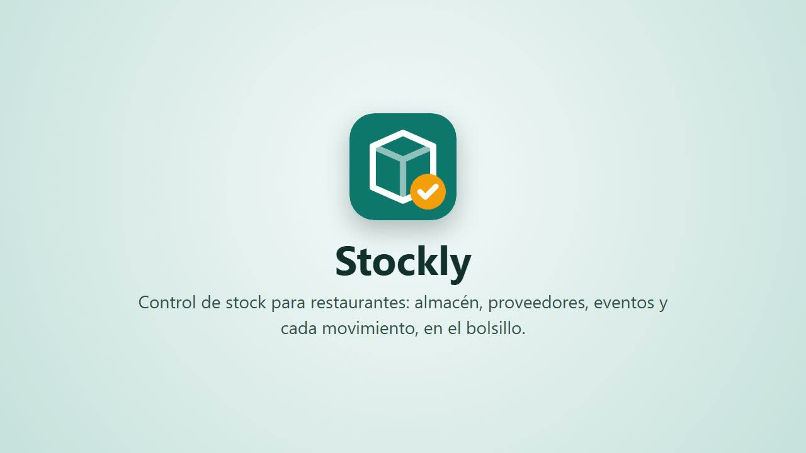
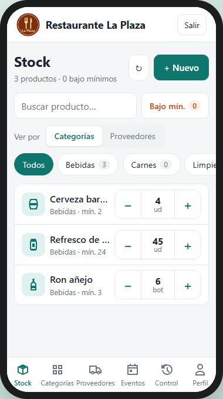
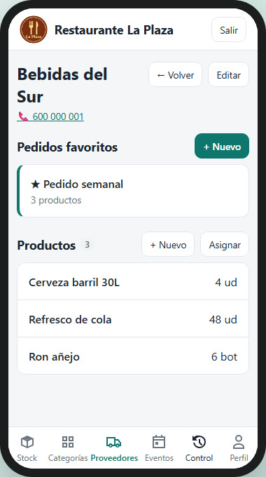
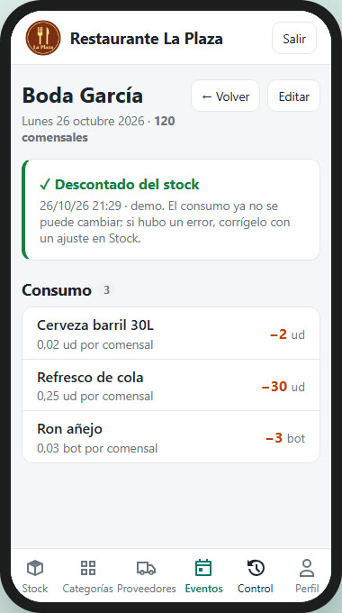
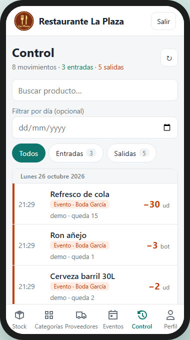

<p align="center">
  
</p>

<h1 align="center">Stockly</h1>

<p align="center">
  <strong>Control de stock para restaurantes y empresas de eventos, en el móvil.</strong><br />
  Angular + Supabase, sin backend propio.
</p>

<p align="center">
  <a href="https://quiquealonso.github.io/stockly/"><strong>Documentación y vídeo</strong></a> ·
  <a href="docs/media/stockly-demo.mp4">Vídeo (MP4)</a> ·
  <a href="#puesta-en-marcha">Puesta en marcha</a>
</p>

<p align="center">
  <a href="https://quiquealonso.github.io/stockly/#video">
    
  </a>
</p>

<p align="center">
  
  
  
  
</p>

## Qué hace

- **Stock**: cantidad, unidad (ud, kg, l, cajas…) y mínimo de cada producto. Botones −/+ grandes,
  entradas y salidas de cualquier cantidad, vista por categorías o por proveedores y filtro
  «bajo mínimos».
- **Proveedores**: un producto puede venir de varios proveedores, pero su recuento es uno solo.
- **Pedidos favoritos**: lo que se pide siempre a un proveedor, con sus cantidades. Se copia la
  lista para enviarla y, al recibir el pedido, se suma todo al stock de una vez.
- **Eventos**: se apunta el consumo y se descuenta del stock en un paso (una sola vez; si falta
  stock, no descuenta nada). Los comensales dan el consumo por persona como referencia.
- **Control**: historial de cada movimiento (ajuste, pedido, evento…), con quién, cuándo y
  cuánto. Los toques seguidos de −/+ se agrupan en un solo registro.
- **Perfil**: datos y logo de la empresa, que aparece en la cabecera.

## Cómo está hecha

| Parte | Tecnología | Carpeta |
| --- | --- | --- |
| Front | Angular 22 (standalone, signals), CSS propio, mobile-first | `frontend/` |
| Datos | Supabase: PostgreSQL + Auth + API REST, vía `supabase-js` | `supabase/` |
| Móvil | Capacitor (APK Android) sobre el mismo front | `frontend/android/` |
| Vídeo | Grabación automática con Playwright sobre un entorno demo | `video/` |
| Web | GitHub Pages | `docs/` |

**Sin backend propio**: la lógica que tiene que ser segura vive en la base de datos.
- **RLS**: solo entra el personal de la tabla `staff`, y `anon` no tiene acceso.
- **Funciones atómicas**: `adjust_stock`, `receive_order`, `consume_event`, `save_favorite_order`…
  Dos personas tocando el mismo producto a la vez no se pisan.
- **Trigger de historial**: registra cada cambio de cantidad y la app solo puede leerlo.

Todo está en [`supabase/schema.sql`](supabase/schema.sql), que es idempotente.

Detalle funcional y cada caso decidido en [`context.md`](context.md). APK en [`MOVIL.md`](MOVIL.md).

## Puesta en marcha

1. **Supabase**: crea un proyecto y, en *SQL Editor*, ejecuta `supabase/schema.sql`. Opcional:
   `supabase/seed.sql` con una empresa y datos ficticios.
2. **Expón el esquema**: añade `aletes` en *Settings › Data API › Exposed schemas*.
3. **Usuarios**:
   - En *Authentication › Users* crea las personas del equipo (con *Auto Confirm User*).
   - En *Sign In / Providers* desactiva *Allow new users to sign up*.
   - Dales acceso y da de alta la empresa:

   ```sql
   insert into aletes.staff (email) values ('persona@empresa.com');
   insert into aletes.companies (name) values ('Mi restaurante');  -- si no usaste seed.sql
   ```

4. **Front**: los valores reales van en `environment.local.ts`, que está ignorado por git:

   ```bash
   cd frontend
   cp src/environments/environment.ts src/environments/environment.local.ts
   # rellena supabaseUrl y supabaseAnonKey (Project Settings › API)
   npm install
   npm start          # http://localhost:4200
   ```

   La clave *publishable / anon* es pública por diseño. **Nunca** pongas la `service_role` ni la
   contraseña de la base de datos.

5. **Móvil**: `cd frontend && npm run apk`. Requiere Android Studio; detalles en [`MOVIL.md`](MOVIL.md).

## Vídeo de demostración

Se graba solo, sobre un esquema demo aparte (`aletes_demo`) que se crea desde cero, con una
empresa ficticia. Ver [`video/README.md`](video/README.md).

## Ideas

- Motivo en las salidas (merma, rotura, consumo propio…).
- Proponer el pedido a cada proveedor a partir de lo que está bajo mínimos.
- Calcular el consumo de un evento a partir de los comensales y de eventos parecidos.
- Roles (encargado / cocina) con RLS por rol.
